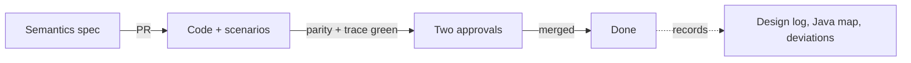

# Conversion

Aurelius Atlas re-implements Apache Atlas 2.4.0 in Python with Elasticsearch 9 as its only store,
keeping the REST API and the dashboard ([ADR 046](../adr/046-the-catalogue-keeps-its-public-contract.md),
[ADR 047](../adr/047-one-search-store-is-the-system-of-record.md)). The work proceeds in increments
([ADR 051](../adr/051-the-conversion-proceeds-in-specified-increments.md)); this page is the roadmap and
the status of each one.

The ledger in this section is the central record of the conversion:

| Page                                            | What it holds                                                          |
| ----------------------------------------------- | ---------------------------------------------------------------------- |
| [Design Log](./design-log.md)                   | Numbered technical decisions (`DD-NNN`), never edited once accepted    |
| [Java to Python Map](./java-map.md)             | Which Java module or class becomes which Python module, and its status |
| [Deviations from Apache Atlas](./deviations.md) | Every intended behaviour difference, referenced by the parity report   |
| [Increments](./increments/index.md)             | The semantics specification of each increment                          |

## Definition of done for an increment

An increment is specified before it is built and proven before it is accepted
([ADR 051](../adr/051-the-conversion-proceeds-in-specified-increments.md)). The
checks a PR must pass:

- [ ] Semantics spec in `increments/`, every rule has an id
- [ ] Every new public function has a test that names it (`@pytest.mark.covers`)
- [ ] Every rule id is named by at least one test
- [ ] Parity scenarios for the endpoints in scope pass, each citing its Atlas source (ADR 052)
- [ ] `nx affected -t lint typecheck test e2e -c ci` is green and the coverage gate holds
- [ ] Design log, Java map and deviations updated; ADR written if a business-level decision was made
- [ ] The test report shows the increment's rules and endpoints as green
- [ ] Conventional-commit title and two human approvals

## Roadmap

Status values: _planned_, _in progress_, _in review_, _done_.

| #    | Increment                       | Semantics in scope                                                                                                                                   | Java origin                                                                               | Status      |
| ---- | ------------------------------- | ---------------------------------------------------------------------------------------------------------------------------------------------------- | ----------------------------------------------------------------------------------------- | ----------- |
| 0.1  | Adopt the template              | Remove unused slices, rename, ADRs 046–051, this ledger                                                                                              | –                                                                                         | done        |
| 0.2  | Elasticsearch infrastructure    | `dev/elasticsearch`, store library skeleton, health check                                                                                            | –                                                                                         | done        |
| 0.3  | Test report and traceability    | `covers` marker, function-to-test checker, HTML test report in CI                                                                                    | –                                                                                         | in progress |
| 0.4  | Parity harness                  | Scenario format, runner, comparison, deviations, report section                                                                                      | –                                                                                         | in progress |
| 0.5  | Server skeleton                 | `apps/aurelius-atlas-server`; admin version, status, session, liveness and readiness                                                                 | `AdminResource` (part)                                                                    | in progress |
| 0.6  | Dashboards served               | `dashboardv2` at `/` and `dashboardv3` at `/n/`, built from the vendored 2.4.0 source                                                                | `dashboardv2`, `dashboardv3`                                                              | in progress |
| 1.1  | Typedef models                  | Enum, struct, classification, entity, relationship, business-metadata definitions                                                                    | `intg/.../model/typedef`                                                                  | in progress |
| 1.2  | Type registry                   | Registry and its updates, built-in, array, map, enum and struct types, attribute types, constraints, errors                                          | `AtlasTypeRegistry`, `AtlasStructType`, …                                                 | in progress |
| 1.3  | Type hierarchies                | Entity and classification super and sub types, inherited attributes, relationship and business metadata types                                        | `AtlasEntityType`, `AtlasRelationshipType`, …                                             | in progress |
| 1.4  | Typedef store                   | Typedefs in Elasticsearch: create, update, delete with the store's checks; loaded at start-up                                                        | `AtlasTypeDefGraphStore`, def stores                                                      | in progress |
| 1.5  | Built-in models and patches     | `addons/models` loaded at start-up, model patches                                                                                                    | `AtlasTypeDefStoreInitializer`, model patches                                             | in progress |
| 1.6  | Types REST                      | `/v2/types/...` read and write                                                                                                                       | `TypesREST`                                                                               | in progress |
| 2.1  | Entity models and validation    | `AtlasEntity`, extended info, headers, validation                                                                                                    | `intg/.../model/instance`, `AtlasEntityType`                                              | planned     |
| 2.2  | Entity store                    | Index layout, GUIDs, unique attributes, optimistic versioning                                                                                        | `AtlasEntityStoreV2`                                                                      | planned     |
| 2.3  | Entity read REST                | By GUID, by unique attributes, bulk, headers                                                                                                         | `EntityREST`                                                                              | planned     |
| 2.4  | Entity write REST               | Create/update, partial update, bulk                                                                                                                  | `EntityREST`, `EntityGraphMapper`                                                         | planned     |
| 2.5  | Delete semantics                | Soft and hard delete, purge                                                                                                                          | `DeleteHandlerV1`, `SoftDeleteHandlerV1`                                                  | planned     |
| 3.1  | Relationship instances          | Relationship CRUD and relationship attributes                                                                                                        | `RelationshipREST`, `AtlasRelationshipStoreV2`                                            | planned     |
| 3.2  | Ownership cascades              | Composition and owned-reference cascades                                                                                                             | `DeleteHandlerV1`                                                                         | planned     |
| 3.3  | Direct classifications          | Add, update, remove, validity periods                                                                                                                | `EntityREST`                                                                              | planned     |
| 3.4  | Classification propagation      | Propagation, blocked propagation, removal                                                                                                            | `ClassificationPropagateTaskFactory`                                                      | planned     |
| 3.5  | Entity audit                    | Audit events and audit REST                                                                                                                          | `EntityAuditRepository`                                                                   | planned     |
| 4.1  | Basic search                    | `SearchParameters`, filters, operators, sort, paging                                                                                                 | `EntitySearchProcessor`, `SearchContext`                                                  | planned     |
| 4.2  | Quick search and suggestions    | Free text, facets, suggestions                                                                                                                       | `AtlasDiscoveryService`                                                                   | planned     |
| 4.3  | DSL parser                      | Atlas DSL grammar to AST                                                                                                                             | `AtlasDSLParser.g4`, `query/`                                                             | planned     |
| 4.4  | DSL execution                   | AST to search queries; declared unsupported forms                                                                                                    | `GremlinQueryComposer` (replaced)                                                         | planned     |
| 4.5  | Saved searches and user profile | Saved search CRUD                                                                                                                                    | `UserProfileService`                                                                      | planned     |
| 5.1  | Lineage                         | Process inputs/outputs, depth, direction, on-demand lineage                                                                                          | `EntityLineageService`                                                                    | planned     |
| 5.2  | Glossary                        | Glossaries, terms, categories, term assignment                                                                                                       | `GlossaryREST`, `GlossaryService`                                                         | planned     |
| 5.3  | Business metadata and labels    | Business metadata attributes, labels                                                                                                                 | `EntityREST`                                                                              | planned     |
| 6.1  | Authentication                  | Keycloak OIDC, session endpoints                                                                                                                     | `AtlasKeycloakAuthenticationProvider`                                                     | planned     |
| 6.2  | Authorization                   | Simple authorizer policies on every endpoint                                                                                                         | `atlas-simple-authz-policy`                                                               | planned     |
| 6.3  | Import, export and migration    | Atlas export ZIP format, migration of an existing Atlas                                                                                              | `ExportService`, `ImportService`                                                          | planned     |
| 6.4  | Hardening                       | Metrics, observability, load test, index tuning                                                                                                      | `AdminResource` metrics                                                                   | planned     |
| 7.0  | Webapp foundation (umbrella)    | The rules every 7.x slice obeys: standalone, signals, shared dumb UI, Vitest and Playwright, `@angular/localize`                                     | Aurelius `apps/atlas`                                                                     | planned     |
| 7.1  | Webapp shell and localisation   | `apps/aurelius-atlas-webapp`: bootstrap, router, runtime config, XLIFF locale bridge, OTel telemetry                                                 | Aurelius `apps/atlas/src/app`, `libs/i18n`                                                | in progress |
| 7.2  | Shared UI components            | Legacy shared components as dumb `aurelius-atlas-ui` components, each with a story                                                                   | Aurelius `libs/components`                                                                | in progress |
| 7.3  | API client and auth wiring      | The Atlas REST client in `aurelius-atlas-data-access`; Keycloak providers and bearer-token interceptor                                               | Aurelius `libs/atlas/api`, `libs/http`                                                    | in progress |
| 7.4  | Search                          | Query and results, the first slice with real data (on hold: gated by server 4.1/2.3, DD-054)                                                         | Aurelius `apps/atlas/src/app/search`                                                      | planned     |
| 7.5  | Landing page (browse)           | Hero, context cards, info modals; search affordances join 7.4 (DD-054); Shell chrome ported by 7.11 (DD-056)                                         | Aurelius `apps/atlas/src/app/search/browse`                                               | in progress |
| 7.6  | Entity details                  | Routed details skeleton (route, header, breadcrumbs, properties shell — DET-01..07); the data spine joins server 2.3 (DD-096, DD-097)                | Aurelius `apps/atlas/src/app/search/details`                                              | in progress |
| 7.7  | Entity editor                   | Create and edit forms with validation                                                                                                                | Aurelius `apps/atlas/src/app/search/{create,edit}-entity`                                 | planned     |
| 7.8  | Governance quality and domains  | Classifications, governance quality, domains                                                                                                         | Aurelius `apps/atlas/src/app/dashboards`                                                  | planned     |
| 7.9  | Delete, audit and detail cards  | Delete flow, audit events, the remaining detail cards                                                                                                | Aurelius `apps/atlas/src/app/search`                                                      | planned     |
| 7.10 | Webapp served                   | The webapp served as the product interface; the example app retires (DV-11)                                                                          | –                                                                                         | planned     |
| 7.11 | Shell chrome                    | Header and footer around every screen: brand, docs, language switch, account menu; search bar joins 7.4 (DD-056)                                     | Aurelius `libs/shell`                                                                     | in progress |
| 7.12 | Theme, branding and layout      | Aurelius palette, legacy type ramp, forced light mode, logo, pinned navbar, footer below the fold (SHM-01..07)                                       | Aurelius `@models4insight/styles`, `libs/shell`                                           | in progress |
| 7.13 | UI components: details set      | Breadcrumbs, entity-card, properties-item, select as dumb components (UIC-11..15, DD-066/067)                                                        | Aurelius `search/components/{bread-crumbs,cards}`, `properties-item`, `components/select` | in progress |
| 7.14 | Settings panel                  | Drawer with theme, language, time zone, page size, telemetry; header gear (SPL-01..13, DD-069..073)                                                  | – (new feature, DV-12)                                                                    | in progress |
| 7.15 | Alerts drawer                   | Bell with severity badge, routed drawer, grouped alert feed, inbox bar with read tracking, runtime/HTTP error capture (ALR-01..12, DD-083..095)      | – (new feature, DV-13)                                                                    | in progress |
| 7.16 | UI components: details chrome   | classification-chip, type-name, details-navigation, section-stats as dumb components (UIC-16..20, DD-099..102)                                       | Aurelius `search/components/classification`, `type-name`, `details/components/navigation` | in progress |
| 7.17 | Collector ingest auth           | Two-leg OTLP ingest: user JWTs on the browser leg (OIDC), shared token on the service leg, loopback-pinned publishes (CIA-01..05, DD-103)            | – (platform-side, extends ADR 039)                                                        | in progress |
| 7.18 | Collector ingest identity       | Per-service ingest identity: client-credentials JWTs on the per-service leg (OIDC), azp-stamped writes, shared-token legacy leg (CIA-06..10, DD-107) | – (platform-side, extends ADR 039)                                                        | in progress |

## After phase 0

!!! WARNING "Two expat CVEs are accepted on a temporary basis"

    CVE-2026-77214 and CVE-2026-102633 (`expat`/`libexpat` 2.8.5-r1, from the server image's
    hardened base) are fixed upstream in 2.9.0-r0 but accepted in SonarCloud because no hardened
    base image carried the fix yet. The acceptance expires with the next base-image refresh —
    the checklist below is the re-decision, and an accepted risk that nobody re-checks is drift.

To do once the last 0.x increment is done:

- [ ] **Re-check the accepted expat vulnerabilities.** CVE-2026-77214 and CVE-2026-102633 in
      `expat` and `libexpat` 2.8.5-r1 come from the base image `dhi.io/python:3.14-alpine3.24` of
      `aurelius-atlas-server`, and are fixed in 2.9.0-r0. They were accepted in SonarCloud on #85, because
      no hardened image with the fix existed yet. Before closing them:
    - Check that the current base image ships expat 2.9.0 or later.
    - Check that SonarCloud has closed the four issues as fixed.
    - If either check fails, reopen the issues and decide again.

## After the plan

To do once 6.4 is done, not numbered as an increment yet
([DD-019](./design-log.md#dd-019-the-template-examples-stay-until-the-plan-is-done)):

- [ ] **Remove the template's examples.** The FastAPI example service, the Angular example screen,
      `aurelius-atlas-example`, `aurelius-atlas-sdk`, `libs/angular/*`, `libs/styles`, `dev/postgres`
      and the Angular, Storybook and Chromatic toolchain leave (ADR 050).
    - `dev/keycloak` stays for 6.1 and takes over `pg_hba.conf` from `dev/postgres`.
    - The rules are tested by a test-only `tools/workspace` project without a Sonar target.
    - They are kept until then because the project's second phase needs them again.
