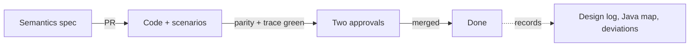

# Conversion

Aurelius Atlas re-implements Apache Atlas 2.4.0 in Python with Elasticsearch 9 as its only store,
keeping the REST API and the dashboard ([ADR 046](../adr/046-the-catalogue-keeps-its-public-contract.md),
[ADR 047](../adr/047-one-search-store-is-the-system-of-record.md)). The work proceeds in increments
([ADR 051](../adr/051-the-conversion-proceeds-in-specified-increments.md)); this page is the roadmap and
the status of each one.

The ledger in this section is the central record of the conversion:

| Page                                            | What it holds                                                          |
| ----------------------------------------------- | ---------------------------------------------------------------------- |
| [Design Log](./design-log.md)                   | Numbered technical decisions (`DD-NNN`), never edited once accepted    |
| [Java to Python Map](./java-map.md)             | Which Java module or class becomes which Python module, and its status |
| [Deviations from Apache Atlas](./deviations.md) | Every intended behaviour difference, referenced by the parity report   |
| [Spec Map](./spec-map.md)                       | Which project's `specs/` holds each increment                          |
| [Increments](./increments/index.md)             | The specifications written before the per-project move, as history     |

## Definition of done for an increment

An increment is specified before it is built and proven before it is accepted
([ADR 051](../adr/051-the-conversion-proceeds-in-specified-increments.md)). The
checks a PR must pass:

- [ ] Semantics spec in `<project>/specs/N-M-slug/` (the [Spec Map](./spec-map.md) says where),
      every rule has an id
- [ ] Every new public function has a test that names it (`@pytest.mark.covers`)
- [ ] Every rule id is named by at least one test
- [ ] Parity scenarios for the endpoints in scope pass, each citing its Atlas source (ADR 052)
- [ ] `nx affected -t lint typecheck test e2e -c ci` is green and the coverage gate holds
- [ ] Design log, Java map and deviations updated; ADR written if a business-level decision was made
- [ ] Conventional-commit title and two human approvals

## Roadmap

Status values: _planned_, _in progress_, _in review_, _done_.

| #     | Increment                                                   | Semantics in scope                                                                                                                                                                                                                                                                                                                                                   | Java origin                                                                               | Status      |
| ----- | ----------------------------------------------------------- | -------------------------------------------------------------------------------------------------------------------------------------------------------------------------------------------------------------------------------------------------------------------------------------------------------------------------------------------------------------------- | ----------------------------------------------------------------------------------------- | ----------- |
| 0.1   | Adopt the template                                          | Remove unused slices, rename, ADRs 046–051, this ledger                                                                                                                                                                                                                                                                                                              | –                                                                                         | done        |
| 0.2   | Elasticsearch infrastructure                                | `dev/elasticsearch`, store library skeleton, health check                                                                                                                                                                                                                                                                                                            | –                                                                                         | done        |
| 0.3   | Test report and traceability                                | `covers` marker, function-to-test checker, HTML test report (local tools; CI gates dropped, DD-215)                                                                                                                                                                                                                                                                  | –                                                                                         | done        |
| 0.4   | Parity harness                                              | Scenario format, runner, comparison, deviations, report section                                                                                                                                                                                                                                                                                                      | –                                                                                         | done        |
| 0.5   | Server skeleton                                             | `apps/aurelius-atlas-server`; admin version, status, session, liveness and readiness                                                                                                                                                                                                                                                                                 | `AdminResource` (part)                                                                    | done        |
| 0.6   | Dashboards served                                           | `dashboardv2` at `/` and `dashboardv3` at `/n/`, built from the vendored 2.4.0 source                                                                                                                                                                                                                                                                                | `dashboardv2`, `dashboardv3`                                                              | done        |
| 1.1   | Typedef models                                              | Enum, struct, classification, entity, relationship, business-metadata definitions                                                                                                                                                                                                                                                                                    | `intg/.../model/typedef`                                                                  | done        |
| 1.2   | Type registry                                               | Registry and its updates, built-in, array, map, enum and struct types, attribute types, constraints, errors                                                                                                                                                                                                                                                          | `AtlasTypeRegistry`, `AtlasStructType`, …                                                 | done        |
| 1.3   | Type hierarchies                                            | Entity and classification super and sub types, inherited attributes, relationship and business metadata types                                                                                                                                                                                                                                                        | `AtlasEntityType`, `AtlasRelationshipType`, …                                             | done        |
| 1.4   | Typedef store                                               | Typedefs in Elasticsearch: create, update, delete with the store's checks; loaded at start-up                                                                                                                                                                                                                                                                        | `AtlasTypeDefGraphStore`, def stores                                                      | done        |
| 1.5   | Built-in models and patches                                 | `addons/models` loaded at start-up, model patches                                                                                                                                                                                                                                                                                                                    | `AtlasTypeDefStoreInitializer`, model patches                                             | done        |
| 1.5b  | The m4i data dictionary types                               | The m4i data dictionary types loaded at start-up after Atlas's models, on by default (MDD-01..04, ADR 058, DD-362)                                                                                                                                                                                                                                                   | — (`m4i_atlas_core`)                                                                      | in review   |
| 1.6   | Types REST                                                  | `/v2/types/...` read and write                                                                                                                                                                                                                                                                                                                                       | `TypesREST`                                                                               | done        |
| 2.1a  | Entity models                                               | `AtlasEntity`, extended info, headers, object ids, classifications, mutation responses                                                                                                                                                                                                                                                                               | `intg/.../model/instance`                                                                 | done        |
| 2.1b  | Value types                                                 | Value side of the built-in, enum, array and map types; the Atlas JSON codec (DD-025, DD-038)                                                                                                                                                                                                                                                                         | `AtlasBuiltInTypes`, `AtlasArrayType`, `AtlasMapType`                                     | done        |
| 2.1c  | Entity validation                                           | Value side of the struct, classification, entity, relationship and business metadata types                                                                                                                                                                                                                                                                           | `AtlasStructType`, `AtlasEntityType`                                                      | done        |
| 2.2   | Entity store                                                | Index layout, GUIDs, unique attributes, optimistic versioning                                                                                                                                                                                                                                                                                                        | `AtlasEntityStoreV2`                                                                      | done        |
| 2.3   | Entity read REST                                            | By GUID, by unique attributes, bulk, headers                                                                                                                                                                                                                                                                                                                         | `EntityREST`                                                                              | done        |
| 2.4   | Entity write REST                                           | Create/update, partial update, bulk                                                                                                                                                                                                                                                                                                                                  | `EntityREST`, `EntityGraphMapper`                                                         | done        |
| 2.5   | Delete semantics                                            | Soft and hard delete, purge, owned-reference cascades (DD-060)                                                                                                                                                                                                                                                                                                       | `DeleteHandlerV1`, `SoftDeleteHandlerV1`                                                  | done        |
| 3.1a  | Relationship instances                                      | Relationship CRUD, relationship storage, entity deletes removing relationships                                                                                                                                                                                                                                                                                       | `RelationshipREST`, `AtlasRelationshipStoreV2`                                            | done        |
| 3.1b  | Relationship attributes                                     | `relationshipAttributes` in entity reads and writes, legacy ends and inverse references through relationships                                                                                                                                                                                                                                                        | `EntityGraphMapper`, `EntityGraphRetriever`                                               | done        |
| 3.2   | Ownership cascades                                          | Owned entities an update replaces or drops, and their revival (composition through relationships in deletes: 3.1b, DD-067)                                                                                                                                                                                                                                           | `DeleteHandlerV1`, `EntityGraphMapper`                                                    | done        |
| 3.3a  | Direct classifications                                      | Add, update, remove, validity periods; classifications read with entities                                                                                                                                                                                                                                                                                            | `EntityREST`, `AtlasEntityStoreV2`, `EntityGraphMapper`                                   | done        |
| 3.3b  | Bulk classifications                                        | `bulk/setClassifications`                                                                                                                                                                                                                                                                                                                                            | `ClassificationAssociator`                                                                | done        |
| 3.4a  | Classification propagation                                  | Propagation within the request, blocked propagation, removal                                                                                                                                                                                                                                                                                                         | `DeleteHandlerV1`, `EntityGraphRetriever`                                                 | done        |
| 3.4b  | Propagation tasks                                           | Deferred propagation tasks, `pendingTasks`, `admin/tasks`                                                                                                                                                                                                                                                                                                            | `ClassificationPropagateTaskFactory`, `TaskManagement`                                    | done        |
| 3.5a  | Entity audit                                                | Entity audit events and audit REST                                                                                                                                                                                                                                                                                                                                   | `EntityAuditListenerV2`, `HBaseBasedAuditRepository`                                      | done        |
| 3.5b  | Classification audit                                        | Classification audit events, `bulk/headers` (DD-074)                                                                                                                                                                                                                                                                                                                 | `EntityAuditListenerV2`, `ClassificationAssociator`                                       | done        |
| 4.1a  | Entity search                                               | `SearchParameters`, entity filters, operators, sort, paging, search fields                                                                                                                                                                                                                                                                                           | `EntitySearchProcessor`, `SearchContext`                                                  | done        |
| 4.1b  | Classification search                                       | Classification filters, wildcards, sub classifications                                                                                                                                                                                                                                                                                                               | `ClassificationSearchProcessor`                                                           | done        |
| 4.2a  | Free text                                                   | Free-text index, basic search `query`, `search/fulltext`                                                                                                                                                                                                                                                                                                             | `FreeTextSearchProcessor`, `SolrIndexHelper`                                              | done        |
| 4.2b  | Quick search and suggestions                                | `search/quick` with facets, `search/suggestions`                                                                                                                                                                                                                                                                                                                     | `AtlasDiscoveryService`, `SearchAggregatorImpl`                                           | done        |
| 4.3   | DSL parser                                                  | Atlas DSL grammar to AST                                                                                                                                                                                                                                                                                                                                             | `AtlasDSLParser.g4`, `query/`                                                             | done        |
| 4.4a  | DSL search of entities                                      | `search/dsl` answering entities: sources, conditions, order, paging; declared unsupported forms                                                                                                                                                                                                                                                                      | `GremlinQueryComposer` (replaced), `TraversalBasedExecutor`                               | done        |
| 4.4b  | DSL projections and traversals                              | `select`, `groupby`, aggregates; referred entities and classification attributes                                                                                                                                                                                                                                                                                     | `SelectClauseComposer`, `SelectClauseProjections`                                         | done        |
| 5.1   | Lineage                                                     | Process inputs/outputs, depth, direction, on-demand lineage                                                                                                                                                                                                                                                                                                          | `EntityLineageService`                                                                    | done        |
| 5.2a  | Glossaries and categories                                   | Glossary and category CRUD, category hierarchy and qualified names                                                                                                                                                                                                                                                                                                   | `GlossaryService`, `GlossaryCategoryUtils`                                                | done        |
| 5.2b  | Glossary terms                                              | Term CRUD, related terms, term categorization                                                                                                                                                                                                                                                                                                                        | `GlossaryService`, `GlossaryTermUtils`                                                    | done        |
| 5.2c  | Term assignment                                             | Terms assigned to entities, meanings on headers, DSL `hasTerm`                                                                                                                                                                                                                                                                                                       | `GlossaryService`, `GlossaryTermUtils`                                                    | done        |
| 5.2d  | Glossary import                                             | Glossary terms imported from CSV or Excel, and the import template                                                                                                                                                                                                                                                                                                   | `GlossaryService#importGlossaryData`, `GlossaryTermUtils`                                 | done        |
| 5.3a  | Labels                                                      | Set, add and remove labels, by GUID and unique attributes; their audit events and checks                                                                                                                                                                                                                                                                             | `EntityREST`, `AtlasEntityStoreV2` (labels)                                               | done        |
| 5.3b  | Business metadata                                           | Business attributes stored, read and written with the entity and by their own endpoints; validation, audit and checks                                                                                                                                                                                                                                                | `EntityREST`, `AtlasEntityStoreV2` (business attributes)                                  | done        |
| 5.3c  | Business metadata import                                    | The CSV template and import of business attribute values                                                                                                                                                                                                                                                                                                             | `EntityREST#importBMAttributes`, `BulkImportResponse`                                     | done        |
| 5.3d  | Business metadata in search                                 | Business attribute values indexed; basic search filters, sorts and answers `<bm>.<attr>`                                                                                                                                                                                                                                                                             | `AtlasEntityType#getBusinesAAttribute`, `GraphBackedSearchIndexer`                        | done        |
| 6.1a  | Authentication                                              | Bearer tokens and the dashboards' sign-in (Keycloak OIDC), the session's user                                                                                                                                                                                                                                                                                        | `AtlasKeycloakAuthenticationProvider`                                                     | done        |
| 6.1b  | The acting user on writes                                   | `createdBy`, `updatedBy` and audit users of every write                                                                                                                                                                                                                                                                                                              | `RequestContext#getUser`                                                                  | done        |
| 4.5   | Saved searches and user profile                             | Saved search CRUD; after 6.1, its owners being users (DD-244)                                                                                                                                                                                                                                                                                                        | `UserProfileService`                                                                      | done        |
| 6.2a  | Authorization: authorizer, types, admin                     | The roles that grant Atlas's privileges, the session's permissions, type definition and purge checks                                                                                                                                                                                                                                                                 | `AtlasAuthorizationUtils`, `AtlasSimpleAuthorizer`                                        | done        |
| 6.2b  | Authorization: entities                                     | Entity, classification, relationship and glossary checks                                                                                                                                                                                                                                                                                                             | `AtlasEntityStoreV2`, `AtlasRelationshipStoreV2`                                          | done        |
| 6.2c  | Authorization: search and lineage                           | Search results scrubbed, lineage checked, type listings filtered, the cluster realm's roles; ADR 038 accepted                                                                                                                                                                                                                                                        | `AtlasAuthorizationUtils#scrubSearchResults`, `#filterTypesDef`, `EntityLineageService`   | done        |
| 6.3a  | Export                                                      | `POST admin/export`: the ZIP of the entities an export reaches, their types and its result; full, connected and incremental fetch                                                                                                                                                                                                                                    | `ExportService`, `ZipSink`, the extractors                                                | done        |
| 6.3b1 | Import mode                                                 | The entity write as an import: GUIDs, system attributes and status kept, classifications and business metadata replaced, missing references left out, no privilege checks, `ENTITY_IMPORT_*` audits                                                                                                                                                                  | `AtlasEntityStoreV2#createOrUpdateForImport`                                              | done        |
| 6.3b2 | Import and migration                                        | `POST admin/import`, `admin/importfile` (a configured folder only): the ZIP read, type definitions merged, entities imported with retries and GUID clashes resolved; importing a Java Atlas 2.4 export migrates it                                                                                                                                                   | `ImportService`, `ZipSource`, `ImportTypeDefProcessor`, `RegularImport`                   | done        |
| 6.3c1 | Import transforms                                           | The `transforms` option of an import: text, attribute, classification and status rewrites per type and its sub types                                                                                                                                                                                                                                                 | `ImportTransforms`, `ImportTransformer`, `ImportTransformsShaper`                         | done        |
| 6.3c2 | Replication and audits                                      | `replicatedTo` and `replicatedFrom`, server records, the export and import audit trail, `admin/expimp/audit`, `admin/server/{name}`                                                                                                                                                                                                                                  | `AuditsWriter`, `ExportImportAuditService`, `AtlasServerService`                          | done        |
| 6.3c3 | Admin audits                                                | `admin/audits`, `admin/audit/{guid}/details`: the audit of purges, exports, imports, type changes and server starts                                                                                                                                                                                                                                                  | `AtlasAuditService`, `TypeDefAuditListener`                                               | done        |
| 6.3c4 | Entity audit aging                                          | `admin/audits/ageout`: the entity audits aged out by age, count and action, on demand and on a schedule                                                                                                                                                                                                                                                              | `AtlasAuditReductionService`, `AuditReductionTask`                                        | done        |
| 6.3d  | Import holds its tasks                                      | The propagation tasks an import records held until it ends, so its writes no longer lose races to them (IMT-01..04, DD-361)                                                                                                                                                                                                                                          | `ImportService`, `TaskManagement`                                                         | in review   |
| 6.4a  | Metrics                                                     | `admin/metrics`: the counts of types, entities and classifications, the server's stats and system details                                                                                                                                                                                                                                                            | `MetricsService`, `AtlasMetricsUtil`                                                      | done        |
| 6.4b  | Metrics history                                             | `admin/metricsstats`, `metricsstat/{time}`, its range and charts: the metrics stored on a schedule and purged after their TTL                                                                                                                                                                                                                                        | `MetricsService` (stats), `AdminResource` scheduling                                      | done        |
| 6.4c  | Observability, alerting, load test                          | The server's logs over OTLP, its dashboard, the alert rules of ADR 040 and their webhook, a load test of concurrent users                                                                                                                                                                                                                                            | —                                                                                         | done        |
| 6.4d  | Retention, index tuning                                     | The lifetimes of ADR 025 for every store, writes that refresh what they wrote, replicas that expand to the cluster (RET-01..07, IDX-01/02)                                                                                                                                                                                                                           | —                                                                                         | done        |
| 6.4e  | Snapshots and restore                                       | Elasticsearch snapshots on a schedule, their check and alert, a restore command and Job, and a rehearsed restore (SNP-01..07)                                                                                                                                                                                                                                        | —                                                                                         | done        |
| 6.4f  | Resilience pages, incident rehearsal                        | The steps for each alert linked from it, the incident record, the first rehearsal (ADR 041); High Availability and Deployment (INC-01..03)                                                                                                                                                                                                                           | —                                                                                         | done        |
| 7.0   | Webapp foundation (umbrella)                                | The rules every 7.x slice obeys: standalone, signals, shared dumb UI, Vitest and Playwright, `@angular/localize`                                                                                                                                                                                                                                                     | Aurelius `apps/atlas`                                                                     | planned     |
| 7.1   | Webapp shell and localisation                               | `apps/aurelius-atlas-webapp`: bootstrap, router, runtime config, XLIFF locale bridge, OTel telemetry                                                                                                                                                                                                                                                                 | Aurelius `apps/atlas/src/app`, `libs/i18n`                                                | done        |
| 7.2   | Shared UI components                                        | Legacy shared components as dumb `aurelius-atlas-ui` components, each with a story                                                                                                                                                                                                                                                                                   | Aurelius `libs/components`                                                                | done        |
| 7.3   | API client and auth wiring                                  | The Atlas REST client in `aurelius-atlas-data-access`; Keycloak providers and bearer-token interceptor                                                                                                                                                                                                                                                               | Aurelius `libs/atlas/api`, `libs/http`                                                    | done        |
| 7.4a  | Search results                                              | Hero search bar, results screen (infinite scroll), entry into 7.6 details, browse affordances (SRH-01..11, UIC-21..23; DD-218/219)                                                                                                                                                                                                                                   | Aurelius `apps/atlas/src/app/search/{search,results}`, browse affordances                 | done        |
| 7.4b  | Search discovery                                            | Facet sidebar (quick-search aggregations), typeahead suggestions, advanced filters — net-new UX with no legacy copy (SDX)                                                                                                                                                                                                                                            | Aurelius `apps/atlas/src/app/search/components/{filter}` (App Search shape, redesigned)   | planned     |
| 7.5   | Landing page (browse)                                       | Hero, context cards, info modals; search affordances join 7.4 (DD-143); Shell chrome ported by 7.11 (DD-145)                                                                                                                                                                                                                                                         | Aurelius `apps/atlas/src/app/search/browse`                                               | done        |
| 7.6   | Entity details                                              | Routed details skeleton (route, header, breadcrumbs, properties shell — DET-01..07); the data spine joins server 2.3 (DD-096, DD-097)                                                                                                                                                                                                                                | Aurelius `apps/atlas/src/app/search/details`                                              | done        |
| 7.7a  | Entity editor drawer                                        | The entityDef-driven create/edit drawer: pencil and `+` affordances gated on `atlas-write`, field forms, the tag box, save through the classification diff, the create type in the route (EDT-01..12, DD-322..337)                                                                                                                                                   | Aurelius `apps/atlas/src/app/search/{create,edit}-entity`                                 | done        |
| 7.7b  | Entity editor: delete flow                                  | The delete affordance and confirm flow around the editor (joins 7.9's delete flow, if it lands separately)                                                                                                                                                                                                                                                           | Aurelius `apps/atlas/src/app/search/edit-entity`                                          | planned     |
| 7.7c  | Entity editor: relationship inputs                          | The entityDef-driven relationship-attribute pickers in the editor drawer: add/remove by the attribute search, save through the entity body (EDT-13..17, DD-338..341)                                                                                                                                                                                                 | Aurelius `apps/atlas/src/app/search/components/editor/components/relationships-input`     | in progress |
| 7.7d  | Entity editor: markdown fields                              | The description fields ride Aurelius's markdown editor: Write/Preview tabs over the shared block, source kept in the save body (EDT-20, UIC-26, DD-352/353)                                                                                                                                                                                                          | Aurelius `libs/components/src/lib/markdown/editor`                                        | in progress |
| 7.8   | Governance quality and domains                              | Classifications, governance quality, domains                                                                                                                                                                                                                                                                                                                         | Aurelius `apps/atlas/src/app/dashboards`                                                  | planned     |
| 7.9   | Delete, audit and detail cards                              | Delete flow, audit events, the remaining detail cards                                                                                                                                                                                                                                                                                                                | Aurelius `apps/atlas/src/app/search`                                                      | planned     |
| 7.10  | Webapp served                                               | The webapp served as the product interface; the example app retires (DV-64)                                                                                                                                                                                                                                                                                          | –                                                                                         | planned     |
| 7.11  | Shell chrome                                                | Header and footer around every screen: brand, docs, language switch, account menu; search bar joins 7.4 (DD-145)                                                                                                                                                                                                                                                     | Aurelius `libs/shell`                                                                     | done        |
| 7.12  | Theme, branding and layout                                  | Aurelius palette, legacy type ramp, forced light mode, logo, pinned navbar, footer below the fold (SHM-01..07)                                                                                                                                                                                                                                                       | Aurelius `@models4insight/styles`, `libs/shell`                                           | done        |
| 7.13  | UI components: details set                                  | Breadcrumbs, entity-card, properties-item, select as dumb components (UIC-11..15, DD-154..155)                                                                                                                                                                                                                                                                       | Aurelius `search/components/{bread-crumbs,cards}`, `properties-item`, `components/select` | done        |
| 7.14  | Settings panel                                              | Drawer with theme, language, time zone, page size, telemetry; header gear (SPL-01..13, DD-157..161)                                                                                                                                                                                                                                                                  | – (new feature, DV-65)                                                                    | done        |
| 7.15  | Alerts drawer                                               | Bell with severity badge, routed drawer, grouped alert feed, inbox bar with read tracking, runtime/HTTP error capture (ALR-01..12, DD-171..176, DD-180..185)                                                                                                                                                                                                         | – (new feature, DV-66)                                                                    | done        |
| 7.16  | UI components: details chrome                               | classification-chip, type-name, details-navigation, section-stats as dumb components (UIC-16..20, DD-189..192)                                                                                                                                                                                                                                                       | Aurelius `search/components/classification`, `type-name`, `details/components/navigation` | done        |
| 7.17  | Collector ingest auth                                       | Two-leg OTLP ingest: user JWTs on the browser leg (OIDC), shared token on the service leg, loopback-pinned publishes (CIA-01..05, DD-193)                                                                                                                                                                                                                            | – (platform-side, extends ADR 039)                                                        | done        |
| 7.18  | Collector ingest identity                                   | Per-service ingest identity: client-credentials JWTs on the per-service leg (OIDC), azp-stamped writes, shared-token legacy leg (CIA-06..10, DD-196)                                                                                                                                                                                                                 | – (platform-side, extends ADR 039)                                                        | done        |
| 7.19  | Frontend failure UX                                         | Test-completeness of the frontend failure paths (DD-214): the data-access error matrix, observability branch holes, config-boot failure, editor failing save/delete, out-of-order search — no new rule ids                                                                                                                                                           | — (proves APC-04, SHL-02/14, SPL-03/04)                                                   | done        |
| 7.20  | Details data spine                                          | The 2.3+7.6 wiring: the details screen fetches the entity by guid, the header/description/properties bind to it, the breadcrumb trail is app state with no source yet (DET-08..14, DD-317/318)                                                                                                                                                                       | Aurelius `apps/atlas/src/app/search/details`                                              | done        |
| 8.0   | Auxiliary API foundation                                    | Shared foundation for the ADR 055 data surface: `aurelius-atlas-otel` + `aurelius-atlas-auth` libs, per-service ingest clients (AUX-01..05, DD-108)                                                                                                                                                                                                                  | Aurelius server `otel_ingest`, FastAPI example app                                        | done        |
| 8.1   | data2model API                                              | Legacy `/extract` as a FastAPI app: archimate rows in, ar3 model string out, native layout (ADR 055, DV-68)                                                                                                                                                                                                                                                          | Aurelius `m4i-data2model`, `m4i-analytics`                                                | done        |
| 8.2   | lineage-model API                                           | Legacy lineage flattening as a FastAPI app: Atlas lineage in, archimate rows out; source stubbed until 5.1 (ADR 055, DV-69)                                                                                                                                                                                                                                          | Aurelius `m4i-lineage-model`                                                              | done        |
| 8.3   | validate-entity API                                         | Legacy validation endpoint as a FastAPI app, shipped as the legacy mock (ADR 055, DV-67)                                                                                                                                                                                                                                                                             | Aurelius `m4i-validate-entity`                                                            | done        |
| 8.4   | API client libraries                                        | Contract + async client library per Python API (CL-01..50, DD-114/115): models move to the lib, the app imports its own contract                                                                                                                                                                                                                                     | Aurelius `libs/atlas/api` (the Angular twin), 8.1-8.3 apps                                | done        |
| 8.5   | lineage-model circuit breakers                              | Per-upstream circuit breakers on the 8.2 chain: outages open the circuit, the open circuit fast-fails 502 (LM-11..15, DD-117, DV-60)                                                                                                                                                                                                                                 | Aurelius `m4i-lineage-model` (bare `requests.post`, no breaker)                           | done        |
| 8.6   | Aux API failure hardening                                   | Test-completeness of the 8.1–8.3 failure paths (DD-125): engine view/dynamic-view paths, transport-failure 502, d2m fast-fail, timeout, negative parity scenarios — no new rule ids                                                                                                                                                                                  | — (proves DTM-04/06/07, LM-07/12/13, VE-01)                                               | done        |
| 8.7   | Client failure contract                                     | Test-completeness of the four client libraries (DD-125): 2xx-with-garbage-body, timeout vs connect error, raising token source, concurrent `with_token` (adds CL-08; proves CL-03/04/05)                                                                                                                                                                             | — (the 8.4 clients, unproven failure paths)                                               | done        |
| 8.8   | Client route coverage: foundation and lineage               | `AtlasClient.lineage` (CL-60..65, DD-307..310): the `LINEAGE_ROOT` fix to `api/atlas/v2/lineage` (DV-69's repoint), the three `LineageREST` client routes, the per-module live-check coverage matrix                                                                                                                                                                 | Aurelius `libs/atlas/api`, `LineageREST`                                                  | done        |
| 8.9   | Client route coverage: entity                               | `AtlasClient.entity` (CLE-01..12, DD-311): the 37 routes of `routes/entity.py` — reads, writes, deletes, classifications, business metadata, labels, audits                                                                                                                                                                                                          | Aurelius `libs/atlas/api` `EntityREST` twin                                               | done        |
| 8.10  | Client route coverage: glossary                             | `AtlasClient.glossary` (CLG-01..09, DD-312): the 32 routes of `routes/glossary.py` — glossaries, categories, terms, assignments, the CSV import                                                                                                                                                                                                                      | Aurelius `libs/atlas/api` `GlossaryREST` twin                                             | done        |
| 8.11  | Client route coverage: relationship and admin writes        | `AtlasClient.relationship` (CLR-01..04) and `AtlasClient.admin` completed (CLW-01..07, DD-313): patches, purge, the export/import ZIP pair, tasks                                                                                                                                                                                                                    | Aurelius `libs/atlas/api` `RelationshipClient`/`AdminClient`                              | done        |
| 8.12  | Client route coverage: saved searches and DSL               | `AtlasClient.search` completed (CSD-01..06): the seven saved-search routes and `GET /dsl`                                                                                                                                                                                                                                                                            | Aurelius `libs/atlas/api` `DiscoveryClient`                                               | done        |
| 8.13  | Angular search twin: saved searches and DSL                 | `SearchService` completed (ACS-01..06, DD-314): the same eight routes of `routes/discovery.py` land on the Angular side, closing the pair DD-217 opened                                                                                                                                                                                                              | Aurelius `libs/atlas/api` `DiscoveryClient` (Angular)                                     | done        |
| 8.14  | Angular admin twin: the admin write routes                  | `AdminService` completed (AAC-01..07, DD-315): the nine write and health routes of `routes/admin.py` — health texts, patches, purge, the export/import ZIP pair, tasks — land on the Angular side, closing the CL-11 pair DD-217 opened                                                                                                                              | Aurelius `libs/atlas/api` `AdminClient` (Angular)                                         | done        |
| 8.15  | Angular lineage twin: the three LineageREST routes          | `LineageService` (ALN-01..04): the three routes of `routes/lineage.py` — the graph, its on-demand form, the unique-attribute lookup — land on the Angular side, closing the CL-61..63 pair DD-217 opened                                                                                                                                                             | Aurelius `libs/atlas/api` `LineageREST` twin (Angular)                                    | done        |
| 8.16  | Angular relationship twin: the four RelationshipREST routes | `RelationshipService` (AREL-01..04): the four routes of `routes/relationship.py` — create, update, the always-wrapped read, the soft/hard delete — land on the Angular side, closing the CLR pair DD-217 opened                                                                                                                                                      | Aurelius `libs/atlas/api` `RelationshipClient` (Angular)                                  | done        |
| 8.17  | Angular entity twin (1/3): the reads and audits             | `AtlasEntitiesService` grows (AEN-01..07): the eight read/audit routes of `routes/entity.py` — guid/unique-attribute/bulk reads, audit events, changed-classification headers — first third of the CLE pair DD-217 opened                                                                                                                                            | Aurelius `libs/atlas/api` `EntityREST` twin (Angular)                                     | done        |
| 8.18  | Angular entity twin (2/3): the writes and deletes           | `AtlasEntitiesService` grows (AEW-01..06): the seven write/delete routes of `routes/entity.py` — create/update, the two partial updates, the soft/hard deletes — second third of the CLE pair DD-217 opened                                                                                                                                                          | Aurelius `libs/atlas/api` `EntityREST` twin (Angular)                                     | done        |
| 8.19  | Angular entity twin (3/3): classifications, BM, labels      | `AtlasEntitiesService` grows (ACL-01..09): the twenty-two classification/business-metadata/label routes of `routes/entity.py` — closing all thirty-seven routes of the CLE pair DD-217 opened                                                                                                                                                                        | Aurelius `libs/atlas/api` `EntityREST` twin (Angular)                                     | done        |
| 8.20  | Angular glossary twin (1/3): the glossaries                 | `GlossaryService` (AGL-01..07): the thirteen glossary routes of `routes/glossary.py` — the paged list, the detailed read, the paged category/term reads, create/update/partial/delete, the template and file import — first third of the CLG pair DD-217 opened                                                                                                      | Aurelius `libs/atlas/api` `GlossaryREST` twin (Angular)                                   | done        |
| 8.21  | Angular glossary twin (2/3): the terms                      | `GlossaryService` grows (AGT-01..06): the eleven term routes of `routes/glossary.py` — reads/creates/updates, the partial update, the delete, the related-terms map, the paged assigned-entities read and its assignment trio — second third of the CLG pair DD-217 opened                                                                                           | Aurelius `libs/atlas/api` `GlossaryREST` twin (Angular)                                   | done        |
| 8.22  | Angular glossary twin (3/3): the categories                 | `GlossaryService` grows (AGC-01..04): the eight category routes of `routes/glossary.py` — the category read, its paged terms and related map, create/update/partial/delete — closing all thirty-two routes of the CLG pair DD-217 opened                                                                                                                             | Aurelius `libs/atlas/api` `GlossaryREST` twin (Angular)                                   | done        |
| 9.1   | Targeted resilience e2e                                     | Real-container outages, three scenarios (DD-125): server down → alert + recovery in the browser, chain upstream down → 502 + recovery, logout round-trip at the real Idp (RSL-01..03)                                                                                                                                                                                | — (no Java twin; Atlas ships no resilience e2e)                                           | done        |
| 9.2   | Server hardening                                            | TLS as a start-up requirement, opaque 5xx with trace-id requestId, security response headers (SRV-06..08, DD-234..236, DV-85/86)                                                                                                                                                                                                                                     | `AtlasBaseExceptionMapper` (cause echo, superseded for 5xx); no header filter to port     | done        |
| 9.3   | Search cost and client IP                                   | Refresh moves from reads to writes, nginx-edge browser rate limit, uvicorn client-IP trust (ENS-11, SRV-09/10, DD-237/238, DV-87)                                                                                                                                                                                                                                    | — (Atlas refreshes nothing on reads, JanusGraph; no limiter to port)                      | done        |
| 9.4   | Edge tracing                                                | The webapp's nginx exports `/api/` spans to the collector's legacy leg; the OTel module builds in the image's dev-stage (ETR-01..03, DD-239)                                                                                                                                                                                                                         | — (no Java twin; nginx/OTLP are Aurelius infrastructure)                                  | done        |
| 9.5   | The server under a path prefix                              | `root_path`: the server's redirects and sign-in under a proxy's path; the standalone stack behind nginx on port 9000, `/atlas2/` and `/auth/` (PFX-01..04, DD-363)                                                                                                                                                                                                   | `EmbeddedServer`                                                                          | in review   |
| 9.5b  | The standalone stack's demo realm                           | The standalone stack's own realm `demo` with the users `atlas` (every right), `steward` (read and write) and `scientist` (read) (DMO-01..03, DD-366)                                                                                                                                                                                                                 | none                                                                                      | in review   |
| 9.5c  | The standalone stack's own store                            | The standalone stack's own Elasticsearch, apart from the dev store the e2e suites write to; `down -v` empties it (SST-01..03, DD-367)                                                                                                                                                                                                                                | none                                                                                      | in review   |
| 9.5d  | The standalone stack's webapp                               | The Aurelius Atlas webapp at the root of the standalone stack, behind its own nginx, signing in to the demo realm (SWA-01..04, DD-369)                                                                                                                                                                                                                               | none                                                                                      | in review   |
| 10.1  | Deployment chart foundation                                 | Component charts in their project folders (`apps/<app>/helm`, `dev/<name>/helm`) + the `helm/` umbrella at the workspace root, the `helm` Nx plugin (targets merge onto the owning projects — a chart is not a project), CI lint/render/publish wiring (CHT-01..07, ADR 057, DD-298, DD-283..294)                                                                    | — (Atlas ships compose/k8s examples for a topology this is not)                           | done        |
| 10.2  | Stateful platform charts                                    | Elasticsearch, Keycloak and its Postgres as self-managed workloads: storage, trust, health, the GKE coredump agent, deploy-time credentials, the root chart-contract suite (CHT-10..19, DD-253..260)                                                                                                                                                                 | –                                                                                         | done        |
| 10.5  | Cluster validation                                          | minikube install script and the smoke suite that proves the install end to end (CHT-50..59)                                                                                                                                                                                                                                                                          | –                                                                                         | planned     |
| 10.3a | App and edge charts                                         | Server, webapp (boot-resolved nginx config + `/config.json`), the three auxiliary APIs (DD-294 closure: the CA mounts, lineage-model upstream URLs); the Gateway API edge at the umbrella (routes, browser certs, BackendTLSPolicy, DD-261 client-IP trust) (CHT-20..32, DD-261..264)                                                                                | –                                                                                         | done        |
| 10.3b | Observability chart                                         | Collector (three ingest legs, OIDC, one egress), Prometheus, Loki, Tempo, Grafana as workloads; the cluster-native scraping decision 10.2 deferred; the apps' and Keycloak's telemetry wiring turned on (10.2 CHT-16's dormant refs go live) (CHT-33..44)                                                                                                            | #160                                                                                      | done        |
| 10.3c | Webapp backend TLS                                          | The webapp's listener serves TLS behind the gateway (DD-270): chart Certificate + leaf mount, `listen 8080 ssl`, the webapp BackendTLSPolicy, HTTPS probes; supersedes DD-285's plaintext-backend clause (CHT-23/25/30 amended)                                                                                                                                      | #161                                                                                      | done        |
| 10.6  | Network segmentation                                        | Namespace default-deny at the umbrella plus per-chart additive ingress allows along the call graph: the gateway browser edges, the server/aux/store/Keycloak-postgres joins, the collector's per-leg and backend peers; the gateway-source knob; probe ports rule-free (CHT-60..73, DD-271/272; pentest finding H2)                                                  | #176                                                                                      | done        |
| 10.7  | Production identity realm                                   | The hardened `aurelius-atlas` realm replaces `master` on clusters: `global.realm` joins the values contract, a minimally-authored prod asset (ROPC off, PKCE, sslRequired all, no seeded users, chart-substituted browser hosts), `master` stays the dev/e2e shape and a supported escape hatch (CHT-74..80, DD-273/274; pentest finding H3)                         | #178                                                                                      | done        |
| 10.8  | Grafana realm login                                         | Grafana becomes a confidential OIDC relying party of the prod realm (its client lands in that asset only): anonymous off, Viewer default with `editor`/`admin` client-role escalation, request-derived root URL so port-forward logins work, Grafana joins the Keycloak 8443 dialers (CHT-81..86, DD-275/276; pentest finding H4)                                    | #182                                                                                      | done        |
| 10.9  | Per-producer ingest credentials                             | Each `otel-*` client gets its own secret: seven placeholders in the prod asset, realm-shaped `<release>-otel-clients` keys and producer joins (per-client on the prod realm, the shared key on `master`), dev compose stays shared (CHT-87..91, DD-277; pentest finding M5)                                                                                          | #183                                                                                      | done        |
| 10.10 | Digest-pinned images, signed charts                         | The nine dhi.io pins carry committed digests (weekly drift guard + refresh PR); every image helper gains a digest-wins branch; own images stay tag-referenced by choice; `helm-sign`/`helm-verify` keyless-sign the published charts with the image chain's identity contract (CHT-92..97, DD-278; pentest finding M9)                                               | #184                                                                                      | done        |
| 10.11 | Low-findings hardening                                      | Webapp edge: tmpfs for the secret-bearing config volume, HSTS via whole-directive placeholder, a browser-sized `/otel/` limiter; observability + store dev stacks pin loopback with a guard (KC issuer/template Postgres deferred); same-repo PR guards, scope-split docs concurrency, ARC digest pins (CHT-98..102, DD-279; pentest lows)                           | #186                                                                                      | done        |
| 10.12 | Server authentication, chart wiring                         | 6.1a's required `AUTH_*` settings land as chart joins: the prod realm gains the `aurelius-atlas-server` confidential client (host-tokenised `login.jsp` redirects), `<release>-server-client` mints once for both the realm-import placeholder and the server's `AUTH_CLIENT_SECRET`, and the aux APIs' `AUTH_REALM` joins `global.realm` (CHT-108..111, DD-296/297) | #195                                                                                      | done        |

## After phase 0

!!! WARNING "Two expat CVEs and a musl CVE are accepted on a temporary basis"

    CVE-2026-77214 and CVE-2026-102633 (`expat`/`libexpat` 2.8.5-r1, from the server image's
    hardened base) are fixed upstream in 2.9.0-r0 but accepted in SonarCloud because no hardened
    base image carried the fix yet; so is CVE-2026-107891 (`musl` 1.2.6-r2, from the webapp image's
    hardened base, fixed in 1.2.6-r3). The acceptance expires with the next base-image refresh —
    the checklist below is the re-decision, and an accepted risk that nobody re-checks is drift.

To do once the last 0.x increment is done:

- [ ] **Re-check the accepted expat vulnerabilities.** CVE-2026-77214 and CVE-2026-102633 in
      `expat` and `libexpat` 2.8.5-r1 come from the base image `dhi.io/python:3.14-alpine3.24` of
      `aurelius-atlas-server`, and are fixed in 2.9.0-r0. They were accepted in SonarCloud on #85, because
      no hardened image with the fix existed yet. Before closing them:
    - Check that the current base image ships expat 2.9.0 or later.
    - Check that SonarCloud has closed the four issues as fixed.
    - If either check fails, reopen the issues and decide again.
- [ ] **Re-check the accepted musl vulnerability.** CVE-2026-107891 in `musl` and `musl-utils` 1.2.6-r2
      comes from the base image `dhi.io/nginx:1.30-alpine3.24` of `aurelius-atlas-webapp` (it moved
      with it from `aurelius-atlas-frontend-example`), and is fixed in 1.2.6-r3. It was accepted in
      SonarCloud on #139, because no hardened image with the fix existed yet. Before closing it:
    - Check that the current base image ships musl 1.2.6-r3 or later.
    - Check that SonarCloud has closed the two issues as fixed.
    - If either check fails, reopen the issues and decide again.

## After the plan

(`DD-019` (the record: `apps/aurelius-atlas-server/specs/0-6-dashboards/design.md`)):

- [x] **Remove the template's examples.** Done: the FastAPI example service, the Angular example
      screen, `aurelius-atlas-example`, `aurelius-atlas-sdk`, `dev/postgres` and `schemas/avro/`
      left once the Atlas server, webapp, and Elasticsearch store replaced them (ADR 050).
    - `dev/keycloak` owns `pg_hba.conf` now (the copy left `dev/postgres`).
    - The Angular libraries, `libs/styles`, and the Angular/Storybook/Chromatic toolchain stay:
      the webapp consumes them, so they are no longer example scaffolding. DD-019's wider plan to
      remove them still applies only if a future increment replaces them.
    - The `otel-postgres` Keycloak ingest client stays by choice: increment 10.9's client set is
      under review (#183..#186, #195), and a realm-asset edit now would collide. A later increment
      drops it with the other unused clients.
