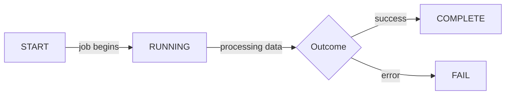
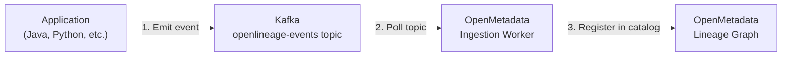

# Dynamic Lineage Events

While static edges declare known relationships, **dynamic lineage events**
capture what actually happens at runtime. They provide a live, real-time
view of data movement as it occurs.

## What Are Dynamic Lineage Events?

A dynamic lineage event is a signal emitted by an application when it processes data. Each event describes:

- **What job ran** — The name of the pipeline or process.
- **When it ran** — A timestamp for the event.
- **What it did** — Whether it started, completed, or failed.
- **What data it touched** — Which inputs were read and which outputs were written.
- **How much data** — Record counts, byte sizes, and other statistics.

## Event Lifecycle

Every data processing job follows a lifecycle, and events are emitted at each stage:

| Event        | When It's Emitted                | What It Tells Us                               |
| ------------ | -------------------------------- | ---------------------------------------------- |
| **START**    | When a job begins                | The job is active and processing has started   |
| **RUNNING**  | Periodically during execution    | The job is still alive and making progress     |
| **COMPLETE** | When a job finishes successfully | The job completed, including output statistics |
| **FAIL**     | When a job encounters an error   | The job failed, including error information    |

## How Events Flow Through the System

Dynamic events follow a well-defined path from the application to the lineage graph:

1. **Emit** — An application emits an OpenLineage event to a dedicated Kafka topic.
2. **Poll** — An ingestion worker continuously reads events from the topic.
3. **Register** — Each event is processed and the lineage information is registered in OpenMetadata.
4. **Visualize** — The updated lineage graph reflects the latest runtime state.

### Why Kafka, and Why mTLS

The transport choices here are constrained by OpenMetadata itself, verified
against its 2.0.x source:

- **Kafka is the only practical transport.** The OpenLineage connector
  supports Kafka (and Kinesis); there is no HTTP ingest endpoint on the
  server, so "just POST events to OpenMetadata" is not an option.
- **The broker listener must be mTLS, not OAuth.** The connector's Kafka
  configuration accepts only username/password SASL — there is no way to
  supply a `sasl.jaas.config` or a token endpoint — so the OAUTHBEARER
  listener every other client uses is unusable here. The ingestion worker
  therefore connects over TLS client certificates (mTLS) to a dedicated
  broker listener.
- **Streaming sources never delete pipelines.** The connector's
  "mark deleted pipelines" behaviour is a no-op for OpenLineage, which is
  what keeps statically registered pipelines in the same service safe.

## What Applications Emit Events

Our platform currently emits dynamic lineage events from:

| Application            | What It Tracks                                                            |
| ---------------------- | ------------------------------------------------------------------------- |
| **Java Producer**      | Messages produced to Kafka topics, including record counts and byte sizes |
| **Debezium JDBC Sink** | Data flowing from Kafka topics into PostgreSQL tables                     |

### Java Producer Example

The Java producer emits events throughout its lifecycle:

- On **startup**, it emits a `START` event declaring the Kafka topic as an output dataset.
- During **operation**, it periodically emits `RUNNING` events with updated statistics.
- On **shutdown**, it emits a `COMPLETE` event with final record counts and byte totals.
- On **error**, it emits a `FAIL` event with error details.

### Debezium JDBC Sink Example

The JDBC sink connector emits events as it processes messages:

- Each batch of messages consumed from a Kafka topic generates an event.
- The event links the source topic (input) to the destination table (output).
- Statistics include the number of records inserted or updated.

## What Stakeholders See

Dynamic events enrich the lineage graph with runtime information:

- **Active data flows** — Which pipelines are currently running and processing data.
- **Execution history** — When pipelines last ran and whether they succeeded.
- **Data volumes** — How many records and how much data flowed through each step.
- **Failure visibility** — Which pipelines failed and when, for quick incident response.

## Static vs Dynamic: How They Complement Each Other

| Aspect             | Static Edges                   | Dynamic Events                                |
| ------------------ | ------------------------------ | --------------------------------------------- |
| **When defined**   | Once, in configuration         | Continuously, at runtime                      |
| **What they show** | Known relationships            | Actual execution                              |
| **Coverage**       | All declared relationships     | Only running applications                     |
| **Detail level**   | Structural (A feeds B)         | Operational (A fed B at 3pm with 10K records) |
| **Use case**       | Impact analysis, documentation | Monitoring, root-cause analysis, auditing     |

Together, static edges and dynamic events provide both the map
(what _should_ happen) and the live traffic view (what _is_ happening).

## Benefits for Stakeholders

- **Real-time visibility** — See data movement as it happens, not just what was configured.
- **Operational awareness** — Know which pipelines are active, idle, or failed.
- **Data volume tracking** — Understand how much data flows through each step.
- **Incident response** — Quickly identify failed pipelines and their downstream impact.
- **Audit evidence** — Timestamped events provide a record of data processing for compliance.
