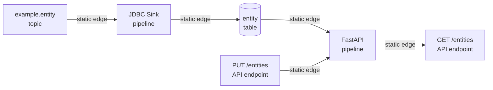

# Static Lineage Edges

While scanning discovers individual data assets, it cannot always determine
how those assets relate to each other. **Static lineage edges** fill this gap
by manually declaring known data relationships.

## What Are Static Lineage Edges?

A static lineage edge is a declaration that data flows from one asset to another. Each edge has:

- **A source** — Where the data comes from (e.g., a database table).
- **A destination** — Where the data goes (e.g., an API endpoint).
- **A description** — Human-readable explanation of the relationship.
- **A source label** — How the edge was determined (manual, inferred, etc.).

Every edge is anchored on a **pipeline** — the job that performs the move.
Data therefore flows `asset → pipeline → asset`, never asset-to-asset
directly. Direct edges skip job attribution (the app doing the work
disappears from the graph) and let read/write paths close into cycles
between anonymous assets; routing each hop through its pipeline keeps
every relationship explainable as "this job moved this data".

## Why Static Edges Are Needed

Automatic scanning can discover that a table exists and that an API endpoint
exists — but it cannot determine that the API reads from that table.
Static edges capture this knowledge explicitly.

Common scenarios where static edges are essential:

| Scenario                         | Example                                                   |
| -------------------------------- | --------------------------------------------------------- |
| **API reads from a table**       | The `/entities/get` endpoint queries the `entity` table   |
| **API writes to a table**        | The `/entities/put` endpoint updates the `entity` table   |
| **Pipeline consumes a topic**    | The Lambda function reads from the `example.entity` topic |
| **Pipeline produces to a topic** | The Lambda function writes to the `example.entity` topic  |

## How Edges Are Defined

Each project maintains a configuration file that declares its lineage edges.
The edges are organized by pipeline — a named process that represents
the project's data flow.

Each static app declares a `serviceType` (`CustomPipeline`) alongside its
pipeline, so registration creates a per-app pipeline service: in Service
Lineage every app is its own box instead of collapsing into one shared
service. Each also declares a `serviceDisplayName`, the label that box shows
— without it the names truncate to the same prefix as their neighbour (most
confusingly the FastAPI pipeline service vs the identically prefixed API
service) and read as duplicates. OpenLineage-event pipelines are the
exception — they live in `aurelius-openlineage`, the service the OM
OpenLineage connector itself is.

Registration runs `tools/openmetadata/register.py` on the host, in the
workspace venv, so its API calls go through OpenMetadata's version-pinned SDK
(`openmetadata-ingestion`, a dev-group dependency kept in lockstep with the
server image) rather than a hand-rolled REST client. Each run re-declares the whole file (idempotent) and prunes
edges anchored on the project's own pipeline that the file no longer lists —
so renaming an endpoint moves the edge instead of leaving an orphan. Edges
carrying a different `source` (notably the OpenLineage events the ingestion
connector merges into the same pipeline) are never pruned.

### Example: FastAPI Application

The FastAPI example routes every endpoint through its pipeline
(`aurelius-fastapi-example-api`): reads leave the table into the pipeline
and the pipeline feeds the GET/SSE endpoints; writes arrive from the
PUT/DELETE endpoints into the pipeline and the pipeline mutates the table.

| Source                    | Destination            | Description                            |
| ------------------------- | ---------------------- | -------------------------------------- |
| `entity` table            | FastAPI pipeline       | Reads for the GET/SSE endpoints        |
| FastAPI pipeline          | `GET /entities`        | List endpoint serves table rows        |
| FastAPI pipeline          | `GET /entities/{guid}` | Detail endpoint serves a table row     |
| FastAPI pipeline          | `GET /entities/sse`    | SSE endpoint streams table changes     |
| `PUT /entities`           | FastAPI pipeline       | Endpoint body destined for the table   |
| `DELETE /entities/{guid}` | FastAPI pipeline       | Endpoint deletes a table row           |
| FastAPI pipeline          | `entity` table         | Upsert/delete writes land in the table |

### Example: AWS Lambda Application

The Lambda example declares edges between Kafka topics and the processing pipeline:

| Source                 | Destination            | Description                                            |
| ---------------------- | ---------------------- | ------------------------------------------------------ |
| `example.entity` topic | Lambda pipeline        | Topic is consumed by the Lambda function               |
| Lambda pipeline        | `example.entity` topic | Pipeline produces processed messages back to the topic |

### Example: Kafka Connect JDBC Sink

The JDBC sink connector declares edges between Kafka topics, the connector pipeline, and database tables:

| Source                 | Destination                | Description                                        |
| ---------------------- | -------------------------- | -------------------------------------------------- |
| `example.entity` topic | JDBC sink pipeline         | Topic is consumed by the connector                 |
| JDBC sink pipeline     | `entity` table             | Connector writes records to the table              |
| JDBC sink pipeline     | `example.entity-dlq` topic | Records the sink could not write are dead-lettered |

## Edge Types

Static edges can connect different types of assets:

| From         | To           | Meaning                                       |
| ------------ | ------------ | --------------------------------------------- |
| Topic        | Pipeline     | The pipeline consumes messages from the topic |
| Pipeline     | Topic        | The pipeline produces messages to the topic   |
| Table        | Pipeline     | The pipeline reads data from the table        |
| Pipeline     | Table        | The pipeline writes data to the table         |
| Pipeline     | API Endpoint | The pipeline serves the endpoint's response   |
| API Endpoint | Pipeline     | The pipeline processes the endpoint's request |

## How Static Edges Appear in the Lineage Graph

Once registered, static edges become part of the lineage graph in OpenMetadata.
They appear alongside dynamically discovered edges, forming a complete
picture of data flow.

## Benefits for Stakeholders

- **Complete lineage picture** — Static edges fill gaps that automatic scanning cannot detect.
- **Impact analysis** — Know which APIs will break if a table schema changes.
- **Data flow documentation** — Edges serve as living documentation of how data moves through the system.
- **Audit trail** — Declared edges provide evidence of data relationships for compliance reviews.

## Why Each Project Uses Static Edges

Static edges are the fallback where no automated lineage source exists —
the choice per project, recorded so it reads as a decision:

| Project             | Why static                                                                                                                                                                                                  |
| ------------------- | ----------------------------------------------------------------------------------------------------------------------------------------------------------------------------------------------------------- |
| FastAPI example     | No request-level lineage emitter; the REST scan gives endpoints, the edges add table access                                                                                                                 |
| AWS Lambda example  | No OpenLineage emitter inside the function (kept lightweight for a template); no Lambda scan exists                                                                                                         |
| Node-RED example    | No OpenLineage integration for Node-RED flows                                                                                                                                                               |
| Frontend example    | A browser SPA has no catalog entity type; a static pipeline records its existence only                                                                                                                      |
| JDBC sink connector | Retained even though a Kafka Connect scan exists: that connector cannot derive lineage from this worker's configuration (see [Scanning](lineage-scanning.md)), so these edges are the sink's lineage source |

The Java producer is the contrasting case: it emits OpenLineage events, so
its only static edge is the pipeline→topic declaration that anchors the
pipeline itself — the topic edge a scan would otherwise own.
