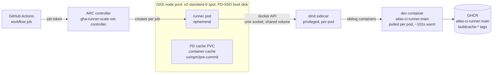

# Self-hosted CI on GKE

> **Status**: plan (cost/benefit decision doc:
> [self-hosted-ci-decision.md](self-hosted-ci-decision.md)). Phase 0 (the
> hosted bridge) is merged; Phase 1 is next.
> Scope: moving the `ci` job of `.github/workflows/ci.yaml` from GitHub-hosted
> runners to self-hosted runners on GKE, run by Actions Runner Controller
> (ARC). The `publish` workflow (the dev container image itself) stays on
> hosted runners - it is the low-frequency builder of the thing the self-hosted
> runners consume. (The plan originally targeted AKS; the Azure subscription's
> quota history moved it to GKE, where the rest of the Aurelius Atlas dev
> resources live. ARC itself is unchanged - the swap is node pool, storage
> class, and auth plugin. Target: the **existing `atlas-dev` Standard cluster**
> (europe-west1) - verified Standard mode, privileged pods admitted; no new
> cluster, no GKE control-plane fee.)

## Why

The bridge (ADR 011 parity + `devcontainers/ci`) proved on hosted runners:

| Evidence (2026-10-25)                     | Result                                                                                                 |
| ----------------------------------------- | ------------------------------------------------------------------------------------------------------ |
| Full pipeline, one dev container, one job | **green 18m34s** (validate 41s · test 4m14 · build+scan 66s · storybook 32s · sonar 9m41)              |
| Image mechanics                           | 8.33 GB pull, warm ~101s, ~2m18s fixed setup per job                                                   |
| DinD                                      | e2e compose + docker-build run on the dev container's own daemon                                       |
| Layer cache                               | registry-backed (GHCR `buildcache-*`), survives the GitHub artifactcache outage that killed `type=gha` |

What hosted still costs us: the 8.3 GB pull is paid **per job** (every runner
is a fresh VM), the Actions cache is a 10 GB LRU pool behind Azure Front Door
(its outage broke builds for hours), runner-minutes are billed, and queued
PRs queue behind a pool we don't control. On GKE: caches become plain
volumes (no 10 GB cap, no AFD, no save step), capacity is a node pool we
size, cost is spot nodes, and from **Shape A** (Phase 3) the image pull
becomes a **per-node** containerd cache. The dind shape keeps the
per-pod pull (GHCR warm, ~101s - the composite login step covers it) while
moving everything else; the pull is what Shape A removes.

## Target architecture



The workflow, the composite action, and `ci-pipeline.sh` stay as they are -
that is the point of the bridge. `devcontainers/ci` inside the runner pod
talks to the ARC dind sidecar's daemon (`docker:dind`, privileged, sharing
`/var/run/docker.sock` with the runner container - the chart's dind mode)
and starts the dev container as a **sibling** on it, exactly as on a hosted
runner. Parity with the developer container is unchanged: same CLI, same
lifecycle scripts, same image digest.

**The one privileged dependency**: the docker-in-docker feature marks the dev
container `privileged: true` (it runs its own dockerd). A privileged sibling
can only be created by a privileged daemon, so the ARC dind sidecar runs
privileged. That is root-on-the-node by definition; it is contained by a
dedicated node pool (taints + tolerations, no other workloads scheduled), a
NetworkPolicy, and treating every pod on that pool as untrusted.

## Shape: runner pod + dev container (recommended)

Two shapes were considered; the first keeps the parity contract:

- **B - runner pod + `devcontainers/ci` (chosen)**: the runner pod is ARC's
  stock runner image; the pipeline runs in the dev container on the dind
  sidecar, i.e. the merged design moved machines. The dev==CI parity property
  (the reason for the bridge) survives untouched.
- **A - runner pod _is_ `atlas-ci-runner`** (the Phase 3 prize): set the
  runner container image to the dev container image and delete
  `devcontainers/ci` from the path - no sidecar, no daemon, and the image is
  pulled by **containerd once per node** (the last per-job cost falls away,
  including the dind store's per-pod pull of the 8.3 GB image). Cheaper per
  run, but the devcontainer lifecycle scripts (`onCreateCommand`/
  `postCreateCommand`) stop running by construction and parity becomes "the
  image digest pins toolchain == dev" plus a bootstrap step. Only worth it
  once Phase 2 is boring.

## What changes in the repo (Phase 1-2)

Small by design - the bridge was built so this is a swap, not a rewrite:

| Concern                                           | Hosted (today)                                                      | GKE                                                                                                      | Change                                                                                                                                                    |
| ------------------------------------------------- | ------------------------------------------------------------------- | -------------------------------------------------------------------------------------------------------- | --------------------------------------------------------------------------------------------------------------------------------------------------------- |
| `runs-on`                                         | `ubuntu-latest`                                                     | `[self-hosted, linux, atlas-ci]`                                                                         | repo config variable `CI_RUNS_ON` used in `runs-on:` - flip one variable to move the fleet, flip back to revert (flag day, per job)                       |
| Disk cleanup step                                 | deletes preinstalled toolchains                                     | no-op (clean node)                                                                                       | behind the existing `disk-cleanup` input; off on GKE                                                                                                      |
| `actions/cache` (features/toolchain caches)       | GitHub cache service (private repo + self-hosted = **unavailable**) | volumes, below                                                                                           | composite gates the two cache steps behind a `use-actions-cache` input; on GKE the same paths are a mounted volume and the steps are skipped              |
| uv/npm/pre-commit caches                          | `container-cache` key, restore/save                                 | PD PVC mounted at the **same paths** (`.container-cache/`)                                               | zero pipeline change - the `UV_CACHE_DIR`/`npm_config_cache`/`PRE_COMMIT_HOME` env already points there; volume = incremental, no 10 GB cap, no save step |
| dev container image                               | pulled per job                                                      | per **pod** on dind (node SSD, ~101s warm; composite's GHCR login covers it), per **node** under Shape A | none in Phases 1-2 (this is Shape A's motivation)                                                                                                         |
| Docker layer cache                                | registry (GHCR)                                                     | registry - unchanged                                                                                     | none (this is why the registry-cache switch pays off: it works from any machine)                                                                          |
| Artifacts, summaries, step outputs                | GitHub                                                              | GitHub - self-hosted supported                                                                           | none                                                                                                                                                      |
| Secrets (`AGE_SECRET_KEY`, Docker Hub, Chromatic) | GitHub                                                              | GitHub - ARC delivers job secrets to the runner pod                                                      | none                                                                                                                                                      |
| GHCR publish (`buildcache-*`)                     | job token, `packages: write`                                        | same                                                                                                     | none                                                                                                                                                      |

The publisher workflow, and every hosted-only workflow (`scan`, `publish*`,
`rotate-keys`, the `build` check), stay hosted in Phases 1-2 - they are
low-frequency and use the hosted cache service.

## Infrastructure

ARC with the Helm charts (`gha-runner-scale-set-controller` +
`gha-runner-scale-set`), ephemeral per-job pods, GitHub App auth (not a PAT -
App installs scope to the repo and survive rotation). All manifests, values,
and the provisioning script live in [`infra/arc/`](../infra/arc/README.md)
(controller, node pool, scale set, status) - this section states the shape,
infra/arc is the source of truth for the how.

The load-bearing values, in words: `containerMode.type: dind` makes ARC
inject a privileged `docker:dind` sidecar per runner pod, sharing
`/var/run/docker.sock` with the runner container (the chart wires
`DOCKER_HOST`; extra sidecar config - resources, the `/var/lib/docker`
emptyDir on the node's SSD - merges in `template.spec.containers`). A
taint + nodeSelector (`ci=true`) keeps CI pods alone on the dedicated pool.
The toolchain caches are a PVC bound into the dev container at the exact
`.container-cache` paths the composite action's env vars already use - the
same content, volume-backed instead of GitHub-cache-backed, so the pipeline
itself does not change. Phase 1 uses the cluster-default PD class
(`standard-rwo`, RWO - fine while canaries are serial; the Filestore API
cannot be enabled in this project). If parallel jobs land on separate nodes,
Phase 2 gives each node its own PD copy (the caches are content-addressed,
so correctness survives).

```bash
gcloud container node-pools create cipool \
    --cluster atlas-dev --location europe-west1 \
    --machine-type n2-standard-8 --spot \
    --enable-autoscaling --min-nodes 0 --max-nodes 3 \
    --disk-type pd-ssd --disk-size 200 \
    --node-taints ci=true:NoSchedule \
    --workload-metadata-disabled
```

`n2-standard-8` (8 vCPU / 32 GiB): the pipeline peaks near 6 vCPU (test
fan-out) and ~30 GB (ES + observability + buildkit); the boot disk is PD-SSD
(the 8.3 GB image + buildkit layers need the room). The pool is spot +
scale-to-zero (`min-nodes 0`): it costs nothing between runs; a spot
preemption mid-run is a failed job that requeues (jobs are idempotent;
registry cache makes the rerun warm). No image-pull secrets are needed: the
runner-side docker client sends GHCR credentials from the composite's
existing login step, and in-container pulls use the job-token login the same
step already does. (Under Shape A the pull moves to containerd, and a pull
secret enters the picture then - see infra/arc notes.)

Auth to the control plane is `gcloud` + the `gke-gcloud-auth-plugin` exec
credential plugin (GCP's kubelogin), baked into the dev container by
`.devcontainer/features/google-cloud-cli` (a vendored
`ghcr.io/dhoeric/features/google-cloud-cli` - the published copy uses the
`apt-key` command Ubuntu 24.10 removed; see its NOTES.md) - gated by
`.devcontainer/smoke.sh`.

## Phases

| Phase             | Scope                                                                                                               | Gate to pass                                                                               | Rollback          |
| ----------------- | ------------------------------------------------------------------------------------------------------------------- | ------------------------------------------------------------------------------------------ | ----------------- |
| 0 - bridge (done) | whole pipeline in `devcontainers/ci` on hosted                                                                      | merged; green 18m34s                                                                       | revert workflow   |
| 1 - canary        | cluster, ARC, node pool, dind; **`.github/workflows/ci-canary.yaml`** (manual) runs on `atlas-ci` beside hosted     | 5 consecutive green canary runs; dev container pull + lifecycle healthy on the dind socket | delete scale set  |
| 2 - pipeline      | full `ci` job on GKE: volume-backed caches, `CI_RUNS_ON` flip; hosted kept warm via weekly cron run                 | 10 green runs across PR types; wall clock ≤ hosted (18m34s); zero secret leaks in logs     | flip one variable |
| 3 - steady state  | scale pool to demand; GHCR retention for `buildcache-*`; evaluate Shape A (runner = image) and moving the publisher | 1 month, no infra tickets                                                                  | -                 |

Phase 1's validate-only job is the same canary trick as the bridge: it
exercises pull, dind, lifecycle scripts, caching, and the GHCR login path,
in ~3 minutes, without spending test minutes on cluster bugs.

## Risks and open questions

- **Privileged dind**: accepted (dedicated spot pool, per-job wipe). If that
  ever stops being acceptable, the fallback is DooD: the runner pod mounts
  the node's containerd - which ARC does not support; the real fallback is
  Shape A, where the runner pod is the dev container and e2e moves to
  K8s-native test namespaces. Bigger lift, no privileged daemon.
- **Spot preemption** = job requeue, not corruption; registry cache makes
  reruns cheap. If preemptions get frequent, drop `--spot`.
- **PD (RWO) cache volume**: Phase 1 serial-canary shape; a job pinned to a
  second node starts cold (rebuilds uv/npm caches, minutes). Filestore RWX
  is blocked by the project's billing-account service policy; the
  content-addressed caches make per-node copies safe.
- **ARC + `actions/cache`**: not available for private repos on self-hosted -
  which is why the plan moves caches to volumes rather than proxying the
  cache API. Do not re-add a cache proxy casually.
- **Retention**: `buildcache-*` tags need a GHCR cleanup policy (already a
  follow-up from the registry-cache switch) - GKE removes the hosted-only
  excuse.
- **Shared cluster**: CI pods share `atlas-dev`'s control plane with the
  dev workloads. ARC's control-plane load is small (ephemeral pods, repo
  scope); the taint keeps CI compute off the dev pool, and dev pods (no
  `ci` toleration) never land on the CI pool. The privileged-dind blast
  radius is the CI node pool's nodes.
- **Cost guard**: `maxRunners 3`, pool `max 3`, spot, scale-to-zero.
  Steady-state estimate: an 18-minute run on n2-standard-8 spot ≈ $0.10, vs
  ~$0.32 hosted per run today - before counting the cache egress and queue
  waits the hosted pool adds. The GKE cluster fee is **not** charged to CI -
  atlas-dev already pays it.

## Decisions to record

When Phase 1 starts, add an ADR (successor to the CI bridge decision):
"CI runs on self-hosted ARC runners on GKE; the dev container remains the
unit of execution; the publisher and low-frequency workflows stay hosted."
Technical notes (ARC values, volume layout, `CI_RUNS_ON` flag day) belong in
`docs/architecture/conversion/design-log.md` as `DD-NNN` entries.
