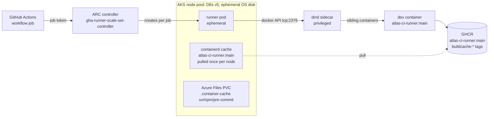

# Self-hosted CI on AKS

> **Status**: plan. Phase 0 (the hosted bridge) is merged; Phase 1 is next.
> Scope: moving the `ci` job of `.github/workflows/ci.yaml` from GitHub-hosted
> runners to self-hosted runners on AKS, run by Actions Runner Controller
> (ARC). The `publish` workflow (the dev container image itself) stays on
> hosted runners - it is the low-frequency builder of the thing the self-hosted
> runners consume.

## Why

The bridge (ADR 011 parity + `devcontainers/ci`) proved on hosted runners:

| Evidence (2026-10-25)                     | Result                                                                                                 |
| ----------------------------------------- | ------------------------------------------------------------------------------------------------------ |
| Full pipeline, one dev container, one job | **green 18m34s** (validate 41s · test 4m14 · build+scan 66s · storybook 32s · sonar 9m41)              |
| Image mechanics                           | 8.33 GB pull, warm ~101s, ~2m18s fixed setup per job                                                   |
| DinD                                      | e2e compose + docker-build run on the dev container's own daemon                                       |
| Layer cache                               | registry-backed (GHCR `buildcache-*`), survives the GitHub artifactcache outage that killed `type=gha` |

What hosted still costs us: the 8.3 GB pull is paid **per job** (every runner
is a fresh VM), the Actions cache is a 10 GB LRU pool behind Azure Front Door
(its outage broke builds for hours), runner-minutes are billed, and queued
PRs queue behind a pool we don't control. On AKS the image becomes a
**per-node** containerd cache (paid once per node, not per run), caches become
plain volumes, capacity is a node pool, and cost is nodes.

## Target architecture



The workflow, the composite action, and `ci-pipeline.sh` stay as they are -
that is the point of the bridge. `devcontainers/ci` inside the runner pod
talks to the ARC dind sidecar's daemon (`DOCKER_HOST=tcp://localhost:2376`)
and starts the dev container as a **sibling** on it, exactly as on a hosted
runner. Parity with the developer container is unchanged: same CLI, same
lifecycle scripts, same image digest.

**The one privileged dependency**: the docker-in-docker feature marks the dev
container `privileged: true` (it runs its own dockerd). A privileged sibling
can only be created by a privileged daemon, so the ARC dind sidecar runs
privileged. That is root-on-the-node by definition; it is contained by a
dedicated node pool (taints + tolerations, no other workloads scheduled), a
NetworkPolicy, and treating every pod on that pool as untrusted.

## Shape: runner pod + dev container (recommended)

Two shapes were considered; the first keeps the parity contract:

- **B - runner pod + `devcontainers/ci` (chosen)**: the runner pod is ARC's
  stock runner image; the pipeline runs in the dev container on the dind
  sidecar, i.e. the merged design moved machines. The dev==CI parity property
  (the reason for the bridge) survives untouched.
- **A - runner pod _is_ `atlas-ci-runner`** (later optimisation): set the
  runner container image to the dev container image and delete
  `devcontainers/ci` from the path - no sibling, no daemon exec. Cheaper per
  run, but the devcontainer lifecycle scripts (`onCreateCommand`/
  `postCreateCommand`) stop running by construction and parity becomes "the
  image digest pins toolchain == dev" plus a bootstrap step. Only worth it
  once Phase 2 is boring.

## What changes in the repo (Phase 1-2)

Small by design - the bridge was built so this is a swap, not a rewrite:

| Concern                                           | Hosted (today)                                                      | AKS                                                                 | Change                                                                                                                                                    |
| ------------------------------------------------- | ------------------------------------------------------------------- | ------------------------------------------------------------------- | --------------------------------------------------------------------------------------------------------------------------------------------------------- |
| `runs-on`                                         | `ubuntu-latest`                                                     | `[self-hosted, linux, atlas-ci]`                                    | repo config variable `CI_RUNS_ON` used in `runs-on:` - flip one variable to move the fleet, flip back to revert (flag day, per job)                       |
| Disk cleanup step                                 | deletes preinstalled toolchains                                     | no-op (clean node)                                                  | behind the existing `disk-cleanup` input; off on AKS                                                                                                      |
| `actions/cache` (features/toolchain caches)       | GitHub cache service (private repo + self-hosted = **unavailable**) | volumes, below                                                      | composite gates the two cache steps behind a `use-actions-cache` input; on AKS the same paths are a mounted volume and the steps are skipped              |
| uv/npm/pre-commit caches                          | `container-cache` key, restore/save                                 | Azure Files PVC mounted at the **same paths** (`.container-cache/`) | zero pipeline change - the `UV_CACHE_DIR`/`npm_config_cache`/`PRE_COMMIT_HOME` env already points there; volume = incremental, no 10 GB cap, no save step |
| dev container image                               | pulled per job                                                      | pulled per **node** (containerd)                                    | `imagePullSecrets` (GHCR) on the pod template; node pool uses the ephemeral OS disk so containerd has room                                                |
| Docker layer cache                                | registry (GHCR)                                                     | registry - unchanged                                                | none (this is why the registry-cache switch pays off: it works from any machine)                                                                          |
| Artifacts, summaries, step outputs                | GitHub                                                              | GitHub - self-hosted supported                                      | none                                                                                                                                                      |
| Secrets (`AGE_SECRET_KEY`, Docker Hub, Chromatic) | GitHub                                                              | GitHub - ARC delivers job secrets to the runner pod                 | none                                                                                                                                                      |
| GHCR publish (`buildcache-*`)                     | job token, `packages: write`                                        | same                                                                | none                                                                                                                                                      |

The publisher workflow, and every hosted-only workflow (`scan`, `publish*`,
`rotate-keys`, the `build` check), stay hosted in Phases 1-2 - they are
low-frequency and use the hosted cache service.

## Infrastructure

ARC with the Helm charts (`gha-runner-scale-set-controller` +
`gha-runner-scale-set`), ephemeral per-job pods, GitHub App auth
(not a PAT - App installs scope to the repo and survive rotation):

```bash
helm install arc \
    --namespace arc-systems --create-namespace \
    oci://ghcr.io/actions/actions-runner-controller-charts/gha-runner-scale-set-controller

helm install atlas-ci-runner \
    --namespace arc-runners --create-namespace \
    --set githubConfigUrl=https://github.com/aureliusenterprise/aurelius-atlas \
    --set githubConfigSecret=arc-atlas-runner-secrets \
    --set minRunners=0 --set maxRunners=3 \
    --set runnerScaleSetName=atlas-ci \
    --set template.spec.nodeSelector."kubernetes\.io/os"=linux \
    --set-string template.spec.tolerations[0].key=kubernetes.azure.com/scalesetpriority \
    --set-string template.spec.tolerations[0].value=spot \
    -f arc-values.yaml \
    oci://ghcr.io/actions/actions-runner-controller-charts/gha-runner-scale-set
```

`arc-values.yaml` carries the three load-bearing blocks:

```yaml
containerMode:
    type: dind
    dockerContainerTemplate:
        securityContext:
            privileged: true
        resources:
            requests: { cpu: 2, memory: 8Gi }
            limits: { cpu: 8, memory: 16Gi }
        volumeMounts:
            - name: dind-scratch
              mountPath: /var/lib/docker
template:
    spec:
        containers:
            - name: runner
              resources:
                  requests: { cpu: 4, memory: 16Gi }
                  limits: { cpu: 8, memory: 24Gi }
              volumeMounts:
                  - name: toolchain-cache
                    mountPath: /__w/aurelius-atlas/aurelius-atlas/.container-cache
        volumes:
            - name: dind-scratch
              emptyDir: {} # wiped per job; see node pool - NVMe temp disk below
            - name: toolchain-cache
              persistentVolumeClaim:
                  claimName: atlas-ci-toolchain-cache
```

Notes: the `toolchain-cache` PVC is Azure Files (NFS, `ReadWriteMany`) so the
uv/npm/pre-commit caches are shared across nodes and persist across pods;
`/var/lib/docker` on an emptyDir is wiped per job - nodes have ~610 GiB of NVMe
temp disk (D8s v5), and with the AKS `LocalPersistentVolume` preview flag
enabled, `medium: LocalRaid` moves the sidecar's overlay onto that NVMe; ARC's
dind template wires `DOCKER_HOST` into the runner container. Node pool:

```bash
az aks nodepool add --resource-group <rg> --cluster-name <aks> \
    --name cipool --node-vm-size Standard_D8s_v5 \
    --node-count 1 --enable-auto-scaling --min-count 0 --max-count 3 \
    --kubelet-disk-type Ephemeral \
    --node-taints "ci=true:NoSchedule" --priority Spot --eviction-policy Delete
```

`Standard_D8s_v5` (8 vCPU / 32 GiB / ~610 GiB NVMe temp): the pipeline peaks
near 6 vCPU (test fan-out) and ~30 GB (ES + observability + buildkit). The
pool is spot + `minCount 0`: it costs nothing between runs; a spot eviction
mid-run is a failed job that requeues (jobs are idempotent; registry cache
makes the rerun warm). GHCR pull secret:

```bash
kubectl -n arc-runners create secret docker-registry atlas-ghcr \
    --docker-server=ghcr.io --docker-username=<bot> --docker-password=<packages:read PAT>
```

...referenced as `imagePullSecrets` for the node's containerd pulls of
`atlas-ci-runner:main` (and `buildcache-*` reads, which the in-container
`ghcr-login` step already handles with the job token).

## Phases

| Phase             | Scope                                                                                                               | Gate to pass                                                                           | Rollback          |
| ----------------- | ------------------------------------------------------------------------------------------------------------------- | -------------------------------------------------------------------------------------- | ----------------- |
| 0 - bridge (done) | whole pipeline in `devcontainers/ci` on hosted                                                                      | merged; green 18m34s                                                                   | revert workflow   |
| 1 - canary        | cluster, ARC, node pool, dind; **validate-only job** runs on `[self-hosted, atlas-ci]` beside hosted                | 5 consecutive green validate runs; GHCR pull cached on node (2nd run pull < 10s)       | delete scale set  |
| 2 - pipeline      | full `ci` job on AKS: volume-backed caches, `CI_RUNS_ON` flip; hosted kept warm via weekly cron run                 | 10 green runs across PR types; wall clock ≤ hosted (18m34s); zero secret leaks in logs | flip one variable |
| 3 - steady state  | scale pool to demand; GHCR retention for `buildcache-*`; evaluate Shape A (runner = image) and moving the publisher | 1 month, no infra tickets                                                              | -                 |

Phase 1's validate-only job is the same canary trick as the bridge: it
exercises pull, dind, lifecycle scripts, caching, and the GHCR login path,
in ~3 minutes, without spending test minutes on cluster bugs.

## Risks and open questions

- **Privileged dind**: accepted (dedicated spot pool, per-job wipe). If that
  ever stops being acceptable, the fallback is DooD: the runner pod mounts
  the node's containerd - which ARC does not support; the real fallback is
  Shape A, where the runner pod is the dev container and e2e moves to
  K8s-native test namespaces. Bigger lift, no privileged daemon.
- **Spot eviction** = job requeue, not corruption; registry cache makes
  reruns cheap. If evictions get frequent, drop `--priority Spot`.
- **Azure Files latency** for uv/npm caches over NFS: measure in Phase 2; the
  escape hatch is one PVC per node (no cross-node sharing, `ReadWriteOnce`)
    - the caches are content-addressed, so correctness survives.
- **ARC + `actions/cache`**: not available for private repos on self-hosted -
  which is why the plan moves caches to volumes rather than proxying the
  cache API. Do not re-add a cache proxy casually.
- **Retention**: `buildcache-*` tags need a GHCR cleanup policy (already a
  follow-up from the registry-cache switch) - AKS removes the hosted-only
  excuse.
- **Cost guard**: `maxRunners 3`, pool `max 3`, spot, scale-to-zero.
  Steady-state estimate: an 18-minute run on D8s v5 spot ≈ $0.10, vs ~$0.32
  hosted per run today - before counting the cache egress and queue waits
  the hosted pool adds.

## Decisions to record

When Phase 1 starts, add an ADR (successor to the CI bridge decision):
"CI runs on self-hosted ARC runners on AKS; the dev container remains the
unit of execution; the publisher and low-frequency workflows stay hosted."
Technical notes (ARC values, volume layout, `CI_RUNS_ON` flag day) belong in
`docs/architecture/conversion/design-log.md` as `DD-NNN` entries.
