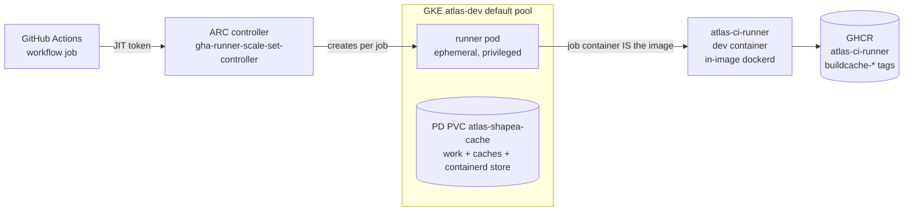

# Self-hosted CI on GKE

> **Status**: as-built (2026-10-26, full pipeline green 41m22s). The `ci` job
> runs on self-hosted ARC runners on GKE, **directly in the dev container
> image** (Shape A). This is
> the architecture record; cost/benefit and the option analysis are in
> [self-hosted-ci-decision.md](self-hosted-ci-decision.md), and the
> operational how-to (setup, deploy loop, the k8s contract, the PVC layout)
> is [`infra/arc/README.md`](../infra/arc/README.md) — that file is the
> source of truth for the mechanics. Scope: the `ci` job of
> `.github/workflows/ci.yaml`. Every other workflow (`publish*`, `scan`,
> `rotate-keys`, docs, `build-devcontainer-image`) stays on GitHub-hosted
> runners — low-frequency, hosted cache service.

## Architecture

ARC (`actions-runner-controller`, GitHub's official chart) turns each `ci`
job into an ephemeral pod whose job container **is**
`ghcr.io/aureliusenterprise/atlas-ci-runner` — the dev container image
developers use. The container command chains the docker-in-docker feature's
`docker-init.sh` (starts an in-image privileged `dockerd`) to
`/opt/actions-runner/run.sh`; the runner binaries are baked by the
`.devcontainer/features/ci-runner` feature. No `devcontainers/ci` wrapper,
no dind sidecar, no sibling container.

Parity with the developer container is by construction: the CI steps run in
the exact image digest developers build, via the same `onCreateCommand`
scripts (`npm.sh`, `uv.sh`) run verbatim as workflow steps. The pipeline
itself (`.devcontainer/ci-pipeline.sh`) is container-agnostic and unchanged.

**The one privileged dependency**: in-image dockerd needs a privileged pod
(the docker-in-docker feature marks the dev container privileged — it runs
its own daemon). Root-on-the-node by definition; contained by the shared
`atlas-dev` cluster's isolation (jobs are our own code) and treated as
untrusted. Same trust model every self-hosted-dind CI has; Shape A moved the
privilege from an ARC-injected sidecar into the job container.

**Why Shape A (runner pod = dev container) over the dind-sidecar bridge**
(the topology the hosted bridge used): the 8.3 GB image is the pod's own
container, cached by containerd **per node** (paid once per node, 2m17s), not
per job. The devcontainers/ci layer, the composite action, the `CI_*`
flag-day variables, and the dind sidecar all fall away. Measured: the
validate gate 9m+ → **3m35s** (setup tax gone); full pipeline target <50 min
on the shared pool.

## Caching (the point of moving off hosted)

The tree is **disposable** (the GitHub-hosted model): `ci.yaml` checks
out with actions/checkout's default clean, and caches live OUTSIDE it.
`node_modules` comes back via `actions/cache` against
[`github-actions-cache-server`](https://gha-cache-server.falcondev.io)
(its own PD volume; private repos get no cache service on self-hosted
runners without one — the forked runner build that makes the stock step
work is documented in
[`infra/arc/README.md`](../infra/arc/README.md)). The uv download cache,
the pre-commit home, and containerd's image store live on dedicated GKE
PersistentVolumes as subPath mounts of the runner pod — validate is
~80s warm and e2e docker builds hit cached layers. The warm work tree is
retired: on Shape A it only survived in-pod restarts, leaked
root-owned dirs and staged diagnostics between jobs, and saved ~70s of
install the cache server now covers. Layout + the reasons for every
mount are in [`infra/arc/README.md`](../infra/arc/README.md).

## Phases (all shipped 2026-10-25; full pipeline green 2026-10-26)

| Phase                  | Scope                                                                | Result                                                                             |
| ---------------------- | -------------------------------------------------------------------- | ---------------------------------------------------------------------------------- |
| 0 — hosted bridge      | whole pipeline in `devcontainers/ci` on hosted                       | green 18m34s; proved the single-job shape                                          |
| 1 — GKE canary (B)     | ARC dind runner, validate-only, on the existing pool                 | 5/5 green, 9m each                                                                 |
| 2 — pipeline on B      | full `ci` on GKE via devcontainers/ci + cache PVC + `CI_*` variables | green 51m13s; no new compute                                                       |
| 3 — **Shape A** (live) | job container = the dev container image; `devcontainers/ci` retired  | full pipeline green **41m22s** (run 40296654173, 2026-10-26), cache hits confirmed |

Phase 3 removed the Phase-2 bridge: the composite action, `ci-canary.yaml`,
`arc-values.yaml`, `toolchain-cache-pvc.yaml`, the `atlas-ci` scale set, and
the six `CI_*` variables are deleted (git history has them).

## Risks (as-built, honest list)

- **Privileged job container = root on the CI node.** Jobs are our own code;
  the shared cluster + node separation bound the blast radius. The fallback
  if that ever stops being acceptable is K8s-native e2e (no privileged
  daemon) — a bigger lift.
- **Serial pool (`maxRunners: 1`, one RWO PVC).** The pipeline peaks near 6
  vCPU / ~30 GB and the RWO volume pins the pod to one node; CI is serial
  today, so no throughput is lost. Levers: constrain the dev docker-compose
  stacks (ES/Keycloak heap), then the documented tainted spot pool.
- **PD (RWO) volume.** A job on a second node starts cold (rebuilds caches,
  minutes); Filestore RWX is blocked by the project's billing-account policy;
  content-addressed caches make per-node copies safe.
- **`actions/cache` unavailable** for private repos on self-hosted — the
  reason caches are volumes, not a proxied cache API. Do not re-add a proxy.
- **Ops ownership**: ARC chart upgrades, classic-PAT rotation (90-day), GHCR
  `buildcache-*` retention. A few hours/quarter.
- **Cost**: idle scales to zero (`minRunners: 0`); the atlas-dev cluster fee
  is not charged to CI. Spot preemption = job requeue, not corruption.

## Decisions

The ADRs/`DD` entries for the CI bridge and this move are tracked in
`docs/architecture/conversion/` (design log) and
[self-hosted-ci-decision.md](self-hosted-ci-decision.md). The operational
contract (why each line of the pod template exists — every one is a failed
trial) is recorded in `infra/arc/README.md`.
